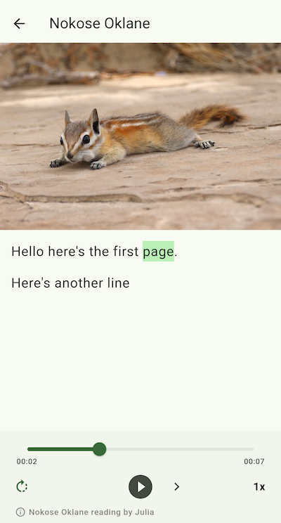

# Readalong Flutter component

A Flutter library for displaying a [ReadAlong Studio](https://github.com/ReadAlongs/Studio) `.readalong` document with word-level audio alignment, or an ELAN `.eaf` document with sentence-level alignment.

This is just a widget, you'll need to import it into a full Flutter app yourself.



## Features

- Parse ReadAlong XML into pages, paragraphs, sentences, aligned words, and metadata.
- Parse ELAN EAF transcriptions and linked translations into a single page with sentence-level audio alignment.
- Play an audio source, seek by tapping aligned words, and highlight the word at the current playback position.
- Synchronize reading controls and sentence highlighting with an external audio or video player.
- Load XML directly or from a Flutter asset.

## Install

Add `readalong` to your Flutter project's dependencies `pubspec.yaml`, by referencing this repo:

```
readalong:
  git:
    url: https://github.com/jmainzy/readalong-flutter.git
```

Alternatively, clone the repo and reference the location in your pubspec:

```
readalong:
  path: ../readalong
```

## Usage

First, [make a Readalong](https://readalong-studio.mothertongues.org/#/), and then download it as "Offline HTML".

For word-level alignment, open the HTML bundle and find the file that ends in
`.readalong`. For sentence-level alignment, use an ELAN `.eaf` transcription.
Put the text file and its audio into your app's assets, then reference them in
the component:

```dart
ReadAlong(
  xmlAsset: 'assets/story.readalong',
  audioSource: AudioSource.asset('assets/story.mp3'),
)
```

An ELAN document is displayed as a single page. Each timed transcription
annotation is treated as one aligned sentence, and linked translation
annotations are displayed below it:

```dart
ReadAlong(
  xmlAsset: 'assets/story.eaf',
  audioSource: AudioSource.asset('assets/story.mp3'),
)
```

You can also load either XML format yourself and pass it as `xml`:

```dart
final xml = await rootBundle.loadString('assets/story.readalong');

ReadAlong(
  xml: xml,
  audioSource: AudioSource.asset('assets/story.mp3'),
)
```

### Use an external player

To synchronize a host-owned player (for example, an embedded video player),
implement `ReadAlongPlaybackController` and pass it instead of `audioSource`.
The controller reports its current position, duration, and playback state
through getters and streams, and handles play, pause, stop, seek, and speed
commands. ReadAlong hides its own audio widget in this mode, leaving playback
and scrubbing to the external player's controls while its position updates
drive text highlighting. The host app remains responsible for creating and
disposing the controller.

```dart
ReadAlong(
  xmlAsset: 'assets/story.eaf',
  playbackController: videoPlaybackController,
)
```

The external controller should emit position updates frequently enough for
sentence highlighting and should report `isCompleted` when playback ends.
`audioSource` and `playbackController` are mutually exclusive.

## Full API

| Option                 | Type                               | Default | Description                                                                                                                                                                                            |
| ---------------------- | ---------------------------------- | ------- | ------------------------------------------------------------------------------------------------------------------------------------------------------------------------------------------------------ |
| `key`                  | `Key?`                             | —       | Standard Flutter widget key.                                                                                                                                                                           |
| `xml`                  | `String?`                          | `null`  | ReadAlong or ELAN XML content supplied directly. Provide exactly one of `xml` or `xmlAsset`.                                                                                                          |
| `xmlAsset`             | `String?`                          | `null`  | Asset path to a `.readalong` or `.eaf` XML file. Provide exactly one of `xml` or `xmlAsset`.                                                                                                          |
| `imagesFolder`         | `String?`                          | `null`  | Asset folder for page images referenced by the XML. For example, `assets/images` resolves `page1.jpg` to `assets/images/page1.jpg`.                                                                    |
| `audioSource`          | `AudioSource?`                     | `null`  | Optional `just_audio` source. Mutually exclusive with `playbackController`.                                                                                                                           |
| `playbackController`   | `ReadAlongPlaybackController?`     | `null`  | Optional caller-owned external player controller. Hides the ReadAlong audio widget and synchronizes text highlighting to the external player's position.                                              |
| `audioTitle`           | `String?`                          | `null`  | Optional title, such as the reader or performer, shown with the audio controls.                                                                                                                        |
| `onAutoplayChanged`    | `ValueChanged<bool>?`              | `null`  | Called when the user changes autoplay between pages.                                                                                                                                                   |
| `onSpeedChanged`       | `ValueChanged<double>?`            | `null`  | Called when the user changes playback speed; receives the speed multiplier.                                                                                                                            |
| `onReaderSurfaceTap`   | `VoidCallback?`                    | `null`  | Called when the reader's image or blank text area is tapped.                                                                                                                                           |
| `onPositionChanged`    | `ValueChanged<ReadAlongPosition>?` | `null`  | Receives reading-position updates and a final snapshot immediately before disposal. The snapshot contains page ID/index, text scroll offset, active word ID, and playback position when playback is enabled.    |
| `showTranslations`     | `bool`                             | `true`  | Whether to show translation sentences marked with `class="translation"`.                                                                                                                               |
| `textStyle`            | `TextStyle?`                       | `null`  | Optional style for the main document text. Uses the theme's larger body style by default.                                                                                                              |
| `translationTextStyle` | `TextStyle?`                       | `null`  | Optional style for translations. Uses smaller, lighter grey text by default.                                                                                                                           |
| `highlightColor`       | `Color?`                           | `null`  | Background color for the word currently being spoken. Defaults to the theme's primary container color.                                                                                                 |
### Fullscreen

On Android and iOS, the reader hides the system bars while the device is in
landscape and restores the normal edge-to-edge system UI when returning to
portrait or when the reader is removed.

Example:

```dart
ReadAlong(
  xmlAsset: 'assets/story.readalong',
  audioSource: AudioSource.asset('assets/story.mp3'),
  onAutoplayChanged: (enabled) => saveAutoplaySetting(enabled),
  onSpeedChanged: (speed) => savePlaybackSpeed(speed),
)
```


## Parsing XML without the widget

```dart
final document = ReadAlongDocument.fromXml(xml);

for (final word in document.words) {
  if (word.isAligned) {
    print('${word.text}: ${word.start} + ${word.duration}');
  }
}
```

## Scope

This package implements the reusable reading/playback experience. The web component's editing tools, annotation controls, persistent user preferences, and custom SVG progress overlays are not part of this initial Flutter library.
